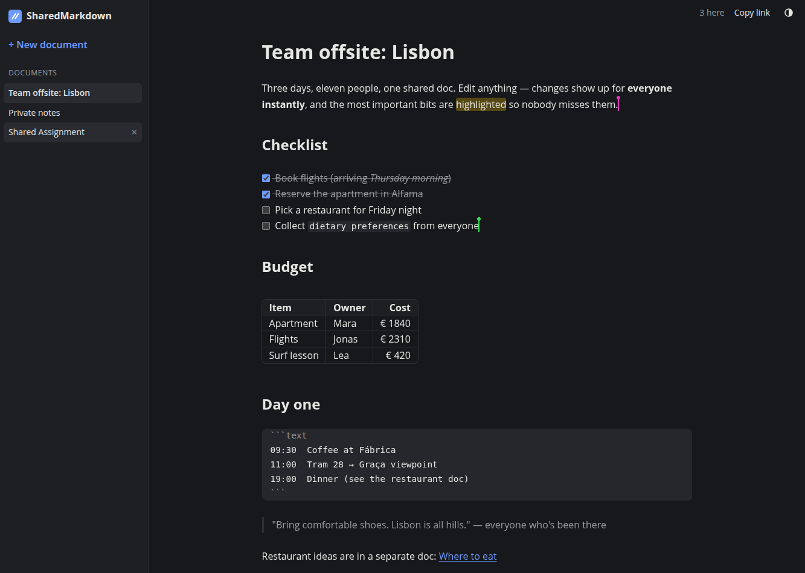

<h1 align="center">SharedMarkdown</h1>

  Markdown you share with a link. No account, no setup: open the page, start writing, send the URL.

  <a href="https://sharedmarkdown.com"><b>sharedmarkdown.com</b></a>

  

## The idea

Writing something together shouldn't start with creating accounts. On SharedMarkdown every visit opens a fresh document at its own URL. Whoever has that link can read and edit it, live, with everyone else who has it.

- **Real-time collaboration.** Edits merge instantly, even when several people type in the same paragraph, and you see where the others' cursors are.
- **Markdown that looks like a document.** Headings, lists, checkboxes, tables, code and images render as you type. The Markdown syntax shows up only where your cursor is, like in Obsidian.
- **Documents link to each other.** Paste one document's link into another, and anyone who opens it finds the linked documents in their sidebar. One shared link can carry a whole set of notes.
- **Paste images.** Screenshots and photos go straight into the text.
- **Your list stays in your browser.** The sidebar remembers the documents you've opened on this device. There's nothing to sign up for and nothing to sign in to.

> Anyone with the link can edit the document, so treat the link like the document itself.

## Development

ASP.NET Core and SQLite on the server, TypeScript and CodeMirror in the browser, deployed as a single app. See [docs/DEVELOPMENT.md](docs/DEVELOPMENT.md) for how it works, running it locally, the abuse limits and deployment.
